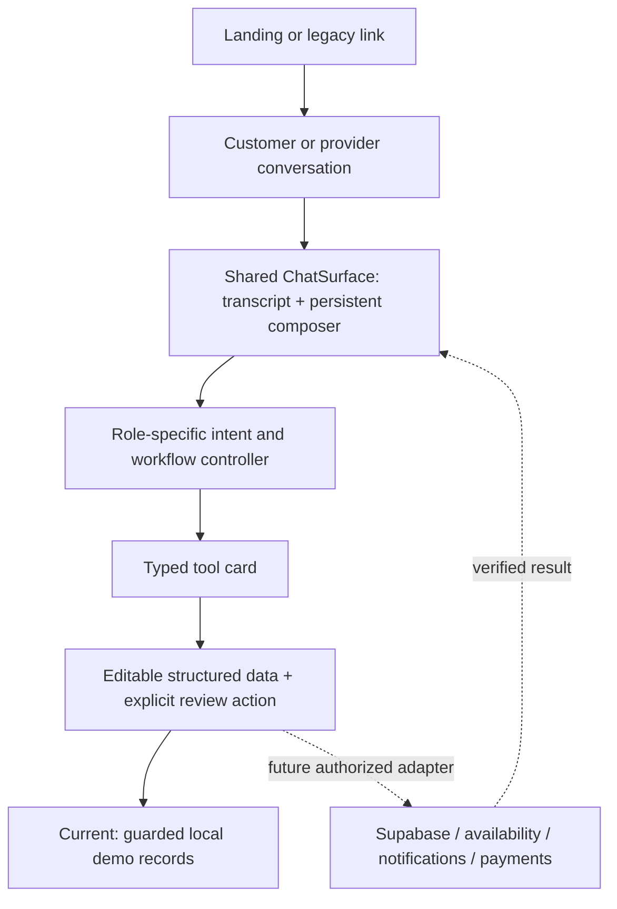

# GOMONO: the conversation is the workspace

## Product contract

Both sides of GOMONO use chat as their primary interface. A customer describes a rental or transport need. A provider describes their business, vehicle or desired operation. The assistant responds with text and an appropriate typed tool card inside that conversation. Service options and business summaries are assistant responses, not separate dashboards.

The landing page remains cinematic. Its Book a Car and List Your Car actions enter the corresponding conversation. An explicit conversational role chooser switches between customer and provider scope. Older links such as #owner, #bookings, #airport and #store open the relevant tool inside chat rather than resurrecting standalone pages.

## Layers

- **ChatSurface** handles messages, quick commands, earlier-tool reopening, transcript scrolling and the always-available composer.
- **CustomerConversation** owns trip preferences, service briefs, self-drive estimates and customer requests. It never loads provider business records.
- **ProviderConversation** owns provider identity, unfinished listing/profile drafts, listings, local-preview selection and its separate inbox. It never reads customer requests as incoming work.
- **Typed tool descriptors** are persisted with turns. They select a known renderer and validated identifiers; they never contain executable HTML, arbitrary SQL or credentials.
- **Reusable card components** handle precise fields and domain review. A form is part of the conversation, not a separate application route.
- **Domain records** use separate persistence keys. A transcript is an explanation/history, not the database or booking authority.

## Customer tools

| Tool            | Purpose                                                                   |
| --------------- | ------------------------------------------------------------------------- |
| Service choices | All eight service types, including custom enquiries                       |
| Trip brief      | Dates, duration, budget mode and vehicle preferences                      |
| Vehicle matches | Sample vehicle comparison cards                                           |
| Vehicle review  | Inline details, dates and a base rental estimate                          |
| Service brief   | Route, driver arrangement, passengers, timing and service-specific fields |
| Request history | Saved self-drive requests and service enquiries                           |

Service briefs can be filled through follow-up messages and edited with precise controls. A pickup answer mentioning an airport must not silently switch a chauffeur enquiry into an airport-transfer workflow. Unknown or incomplete information prompts a question. Target budgets are never presented as verified provider quotes.

## Provider tools

| Tool             | Purpose                                                    |
| ---------------- | ---------------------------------------------------------- |
| Provider profile | Private-owner/fleet/operator identity, services and area   |
| Listing draft    | Vehicle/service details, capacity and rate unit            |
| Fleet            | Saved listings, editing and local-preview selection        |
| Business summary | Compact status inside an assistant message                 |
| Inbox            | Only addressed provider requests once live delivery exists |
| Storefront       | Embedded local showroom preview                            |

Natural-language edits update a draft, not the saved listing. Save buttons explicitly commit local changes. An unfinished draft can be resumed after reload. Quote-only listings display “Quote on request,” not a zero-priced rental. Publishing and payments are never represented as completed without real services.

## UI foundation

Actual MIT-licensed Untitled UI components are vendored at a pinned commit. FieldInput, FieldSelect and FieldTextarea provide a stable app-facing contract around React Aria and Tailwind, preserving labels, validation, focus, hints, optional icons/tooltips and currency prefixes. Native date/time pickers and numeric constraints remain available on mobile. The semantic palette is GOMONO emerald rather than the upstream purple. Tailwind preflight is omitted to preserve the existing landing page.

The app adapter supports native event callbacks for compatibility and a string-value onValueChange API for new integrations. Future API errors should map to field error/hint properties and a conversational failure message. Show disabled/submitting states during real asynchronous operations; never show a completed action before the service confirms it.

## Future integrations

1. **Identity:** Clerk establishes the signed-in actor. Tool execution must independently authorize the customer or provider operation server-side; choosing a role in this demo is not authorization.
2. **Inventory and availability:** Supabase repositories return approved listings, provider ownership and authoritative availability. The assistant asks typed services for results rather than fabricating them.
3. **Quotes and bookings:** quoted price, expiry, fees, terms and hold status are versioned domain results. Saving a request, creating a hold and confirming a paid booking are different operations.
4. **Payments:** initiate hosted secure payment controls from a conversation card and resume the same thread after the provider callback/webhook. Do not put card numbers in transcript text or generic application inputs.
5. **Uploads:** a file-picker card may obtain an authorized upload destination; only record completion after storage succeeds. Store private-document references, not document contents, in protected tool metadata.
6. **Notifications:** delivery state and retries belong to backend services. Report whether a request was actually delivered instead of assuming a notification succeeded.
7. **LLM transport:** replace bounded demo intent/slot handling with a server-side model/tool adapter. Keep the same typed cards, schemas, role scope, confirmation gates and domain operations. No model/API secret belongs in Vite client variables. Re-read version-matched AI SDK docs when adding that transport.

The current release does not add a live LLM, booking engine, payment flow or provider request delivery. It establishes the conversation architecture and component contracts those services must use.

## Persistence and recovery

Customer/provider transcripts use separate versioned keys and retain up to 60 turns. Existing trip messages, self-drive requests and provider listings are preserved. Structured service drafts, listing drafts, profile drafts and estimate dates persist independently of message text. Earlier forms become inactive when a new step opens; reopening creates a fresh interactive tool in the same thread. New chat requires confirmation and clears only that transcript, not business records or saved requests.

## Message deletion and reply presentation

Each customer/provider transcript message has a confirmation-based delete action. Deleting a message removes its text and attached conversation card only. Domain requests, service enquiries, shortlist, profile, listings and unfinished drafts remain separate. An explicitly empty transcript is authoritative and must not fall back to legacy history. Removing the latest turn archives any older form that becomes the new tail; it can be reopened explicitly but must not become active automatically. `toolArchived` is a backward-compatible persisted transcript flag, not a domain permission.

`useReplySequence` is a presentation layer: user text appears immediately, new assistant text follows a brief preparing indicator, and its inline tool appears next. Vehicle/service choices have short staggered entrances. Demo state and records persist independently of those timers. The status is preparation feedback, not a claim of live AI generation, inventory lookup or payment activity. Stored history is rendered immediately and labelled as a previous conversation. Clear, delete, role changes and unmount cancel obsolete timers. Reduced motion retains the sequence with shorter pacing and no moving animations. The composer stays available for drafting while Send and suggestions wait for the current reveal to finish.
